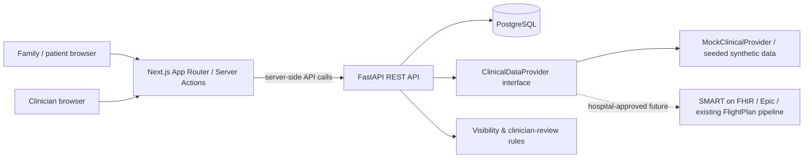

# FlightPlan — Product & Implementation Specification

**Version:** 1.0 — 2026-11-06  
**Purpose:** Build brief for Claude or another engineering agent  
**Primary reference:** 18 FlightPlan tablet wireframes in `wireframes/`  
**Project stage:** Hackathon-ready working prototype with **synthetic data only**, architected for potential future hospital integration.

> **Top-line requirement:** A family-friendly, accessible, exploration-style hospital journey. Families can create a **FlightPlan email/password account without MyChart or Epic**. MyChart and Epic are optional integrations, NOT prerequisites. A FlightPlan account alone never grants access to real patient charts.

---

## 0. Implementation contract — do not negotiate these

1. **Frontend:** Next.js **App Router**, TypeScript, React, Tailwind CSS, Lucide icons. Use current stable, compatible versions with lockfiles. **Absolutely no `src/` directory in the Next.js project.** All frontend code lives directly under `frontend/app`, `frontend/components`, `frontend/hooks`, `frontend/lib`, and `frontend/services`.
2. **Frontend conventions** mirror the provided user file: `app/(public)`, `app/(protected)`, `app/ServerActions`, `app/globals.css`, `app/layout.tsx`, `app/page.tsx`, root `components/`, `hooks/`, `lib/api-format.ts`, `lib/schema.ts`, `lib/auth.ts`, `lib/utils.ts`, `services/*.ts`, and root `proxy.ts`. Actual routes use Next's required lowercase `page.tsx` and `layout.tsx`, while components can use `PascalCase.tsx`.
3. **Backend:** Python 3.12+ FastAPI, Pydantic v2, SQLAlchemy 2.x ORM (typed mappings), PostgreSQL, and Alembic migrations. Use **`uv`** with `pyproject.toml` and committed `uv.lock` for Python dependencies. Implement SQLAlchemy models, Python enums, Pydantic request/response schemas, routers, services, and authorization dependencies — not a single giant `main.py`.
4. **Database:** PostgreSQL only; no SQLite fallback in the running demo. Schema created via **Alembic**, not `Base.metadata.create_all()` on app startup.
5. **One command:** From repo root, `docker compose up --build` must build, start PostgreSQL, run migrations, seed deterministic fictional demo data idempotently, and launch the frontend and API. No manual `npm install`, `uv sync`, `alembic upgrade`, or seed commands. Re-running must work without data duplication.
6. **Authentication:** Email/password registration and sign-in are the **primary, fully working** option. MyChart and Epic sign-in/launch are clearly marked **optional/connected later**. Never ask users to type MyChart/Epic passwords into a FlightPlan-controlled form; future external sign-in uses provider-hosted OAuth/SMART workflows.
7. **Access safety:** A self-registered account may view its own profile, family-authored content, and explicitly assigned **fictional demo** patients. It must not unlock a real EHR patient by entering a name, DOB, MRN, or hospital number. Clinician accounts are institution-provisioned or demo-seeded, **never self-assigned** by registration form.
8. **Patient safety:** No fabricated medications, advice, precautions, prognosis, discharge certainty, or causes of readmission. Everything in demo is labeled fictional. In eventual EHR mode, use source attribution, timestamps, reviewer approval when appropriate, access controls, and separate family observations from chart findings.
9. **Architecture:** Next.js Server Components and Server Actions act as a backend-for-frontend (BFF), calling FastAPI server-to-server. Browser never stores access tokens in localStorage, reads HttpOnly tokens, or contacts private EHR services directly.
10. **Visual fidelity:** Align with all 18 wireframes: dark navy shells, luminous teal accents, rounded pale blue/white content cards, friendly illustration/icons, readable typography, clear statuses. The **family's main journey is a simple path**, not a complex multilane graph. More information appears via recursive drill-down.

### Styling note: wireframes versus supplied file's university palette

The attached file conventions include a request to use University of Cincinnati colors. The **approved FlightPlan wireframes** use navy/teal. Resolve this by retaining **navy/teal as primary app tokens** (critical for alignment) and defining optional **UC black/red/white branding tokens** for a small institutional co-branding accent only when desired. Do not turn the whole medical interface red, or suggest official Cincinnati Children's/UC endorsement. Do not copy protected logos unless assets are provided/authorized.

---

## 1. Product concept and audience

**Name:** FlightPlan — My Care Journey.  
**Value:** A continuous, explorable patient story from admission through procedures, recovery, discharge, time at home, readmission, transfer, or ongoing care. Helps families understand their child's care and participate in conversations without creating another nursing documentation system.

**Users:**

- **Patient**: sees authorized information at appropriate age/consent and comprehension level.
- **Parent/caregiver**: sees only patients to whom they have verified proxy/guardian access; demo may assign synthetic patients directly.
- **Clinician/nurse**: reads a streamlined bedside presentation, reviews family-facing summaries, and continues documenting clinically in the hospital EHR. No second primary charting tool.
- **Admin/demo operator**: manages demo access and synthetic fixtures; not a public role picker.

**Non-goals in first release:** Real patient-data integration, auto-diagnosis, medication administration decisions, unrestricted clinician chat, automated emergency alerts, AI-created discharge forecasts, recovery scores or leaderboards, direct hospital order entry, and replacing MyChart/Epic/EHR.

**Core story:** Whole journey → specific admission → breathing-support sub-journey → individual intubation event; each layer preserves familiar navigation, iconography, breadcrumb/back action, and contextual header.

---

## 2. The 18 wireframes are the product acceptance map

Use the filenames below verbatim as visual reference. Every screen must be reachable and implemented with real UI components, not static PNGs. Create tablet-first layouts, responsive fallback to phone/desktop. The images define **layout and visual style**; clinical text is synthetic illustrative content, not medical recommendations.

| # | Wireframe image | Route (App Router URL) | Data & behavior |
|---|---|---|---|
| 01 | `01_welcome_access.png` | `/welcome` | Family/patient/clinician entry; email/password prominently offered; optional external buttons secondary. Public user cannot assign privileged role. |
| 02 | `02_secure_sign_in_parent_access.png` | `/login`, `/register` | **Replace single mandatory MyChart button** with working FlightPlan email/password form, Register, and optional `Continue with MyChart` only if configured; role/proxy verification messaging. |
| 03 | `03_family_home.png` | `/dashboard` | Greeting, active synthetic patient selector, Journey, Today, My Care, Rounds, History. Provide source freshness chip. |
| 04 | `04_journey_overview_level_1.png` | `/patients/[patientId]/journey` | **Level 1** all encounters as approachable large checkpoints with home intervals; current location; no dense clinical graph. |
| 05 | `05_current_hospital_stay_level_2.png` | `/patients/[patientId]/journey/[nodeId]` | **Level 2** selected admission; sub-checkpoints by clinically meaningful group; chronology, status, back breadcrumb. |
| 06 | `06_breathing_support_level_3.png` | `/patients/[patientId]/journey/[nodeId]` | **Level 3** breathing support; step sequence (tube placed, supported breathing, tube removed, monitoring), visual journey; tap each. |
| 07 | `07_breathing_event_level_4.png` | `/patients/[patientId]/journey/[nodeId]` | **Level 4** one event; plain-language what/why/when, clinical terms toggle, date/source, approved summary, optional read-aloud. |
| 08 | `08_today_s_care_plan.png` | `/patients/[patientId]/today` | Current approved goals, medications summary, next planned procedure, precautions, optional family participation. |
| 09 | `09_medications_changes.png` | `/patients/[patientId]/medications` | Active/recent/past sections, medication purpose, status, dosage only if verified, clinician approved. Don't equate an order with a given dose. |
| 10 | `10_upcoming_tests_procedures.png` | `/patients/[patientId]/procedures` | Planned versus completed, when, what to expect, requirements only if verified. Uncertain schedule labeled tentative. |
| 11 | `11_safety_instructions_what_to_avoid.png` | `/patients/[patientId]/safety` | Confirmed precautions/limitations, source and validity; no invented medical advice. |
| 12 | `12_family_questions_home_observations.png` | `/patients/[patientId]/questions` | Create/edit own saved question, mark for rounds; family-at-home observations separately tagged as family-reported. No promise of urgent delivery. |
| 13 | `13_bedside_rounds_shared_view.png` | `/patients/[patientId]/rounds` | Stepper: journey → current status → today's plan → questions → next milestone; clinician can present; no EHR write-back requirement. |
| 14 | `14_readmissions_continuous_care_history.png` | `/patients/[patientId]/history` | Multiple admissions, chronological home intervals, back into a selected stay's nested journey. |
| 15 | `15_time_at_home_between_admissions.png` | `/patients/[patientId]/history/home/[intervalId]` | Discharge-to-next-admission elapsed days, family observations, clinician-documented return reason if available; **never assert causation from temporal correlation**. |
| 16 | `16_clinician_launch_review.png` | `/clinician/review` | Clinician-only, seeded role or later SMART launch; review/approve summaries, see statuses and source information. Local reviewer access is demo-only unless provisioned. |
| 17 | `17_changing_care_plans_serious_outcomes.png` | `/patients/[patientId]/care-path` | Branching path: changed plan, transfer, extended care, comfort-focused care. No gamified loss/failure or guaranteed home endpoint. Serious outcomes need institutional review and compassionate visual style. |
| 18 | `18_information_levels_accessibility.png` | `/settings/accessibility` | Simple/standard/clinical **presentation depth**, text scale, read aloud (Web Speech API where available with clear local-only behavior), high contrast, supported languages; depth is **not** access permission. |

### First-run flow

1. Open `/welcome` → choose **Family or Patient** → click **Continue with email** → `/register` or `/login`.
2. Register an account (name/email/password), verify in a demo-friendly way if desired; sign in and see fictional Maya's record only if demo patient access has been assigned.
3. Dashboard → My Journey → Level 1 journey (current stay + prior stay + home interval) → tap current stay → Level 2 → tap breathing support → Level 3 → tap tube placement → Level 4.
4. Breadcrumbs go one layer up, not straight to dashboard; browser back also works.
5. Navigate to Today's Plan, Medications, Procedures, Safety, Family Questions, Bedside Rounds, Readmissions, and Accessibility.
6. If a clinician is provisioned, `/clinician/review` shows pending content and allows deliberate approve/reject, recorded in audit log.
7. If MyChart/Epic configuration absent, show a tasteful `Available when your hospital connects FlightPlan` state while email/password remains fully functional.

### Journey rendering contract

- A **single human-readable main route** with 3–6 primary checkpoints at any one time, using semantic icons and statuses, not colored lines or charts that require a legend.
- Drilling into a checkpoint can produce **another journey**, not merely a modal with paragraphs. Each descendant journey has its own 2–6 checkpoints and the same layout language, breadcrumb and active highlight.
- Permit an event with `start_at` and `end_at` (breathing support interval) or instantaneous `occurred_at` (procedure). Parallel events may coexist in data; UI groups them sensibly without falsely claiming universal sequential care.
- Unknown future destination is labeled `What's next?` or `Being reviewed`, not automatic discharge. Planned steps explicitly show uncertainty.
- Accessible controls: meaningful labels, keyboard focus, 44px+ touch targets, non-color status descriptions, readable at 200% text scaling.
- Do not hide sensitive/important information in unlabeled icons or inaccessible animation. No scores, badges implying illness achievement, or streaks.

---

## 3. Authentication and account linking

### Local account — primary, fully implemented

- `POST /api/v1/auth/register` with email, display name, password (and optional user type preference for UI **only**; not privileged clinician assignment).
- `POST /api/v1/auth/login` with email/password.
- `POST /api/v1/auth/logout`, `GET /api/v1/auth/me`, optional refresh/session endpoint.
- Argon2 password hashing via `pwdlib[argon2]`; never store plaintext password. Rate-limit login and handle invalid credential errors without account enumeration in production.
- Create secure **HttpOnly**, `SameSite=Lax` session cookies via Next Server Actions/BFF; `Secure` in HTTPS deployments. `proxy.ts` may redirect unauthenticated users optimistically, but **FastAPI authorization is always authoritative**.
- Never log credentials, tokens, raw patient data, or claim a cookie exists = authorized user. `lib/auth.ts` should fetch `/auth/me` through the server rather than trusting a merely decoded JWT.
- Demo seeding may create `family@flightplan.demo`, `patient@flightplan.demo`, `clinician@flightplan.demo`, all with an explicitly demo-only password configurable by environment. Show the credentials in a clearly labeled demo-mode login hint, never in production.
- Demo family is granted access to **fictional Maya** by fixture. A newly registered account can explore sample/demo records but is **not** permitted to browse real patients or arbitrarily bind to other users' records. Demo explorer can use shared, explicitly synthetic sandbox data when enabled.

### Optional external identity — interface and adapters

- **MyChart (patient/parent)**: optional OAuth/SMART authorization through a provider-managed flow, only with approved hospital configuration and verified patient/proxy permissions. A local account can be linked to an external identity later; not a requirement to use the app in demo mode.
- **Epic (clinician)**: optional EHR-context launch / SMART on FHIR; only authorized provisioned staff, not self-selected role.
- Store only approved external identifiers and token references securely when implemented. Never request patients to provide MyChart/Epic passwords directly to FlightPlan.
- Feature flags: `ENABLE_MYCHART_LOGIN=false`, `ENABLE_EPIC_LAUNCH=false`, `CLINICAL_DATA_PROVIDER=mock` by default.
- Local sign-in **does not imply** clinical EHR access. For actual EHR data, verified identity/guardian rights, role, purpose, consent and institutional agreement are required.

### Role matrix (enforced by API)

| Action | Patient (authorized) | Caregiver (verified proxy) | Clinician (provisioned) |
|---|---|---|---|
| Browse authorized family-facing journey | Yes | As authorized | Yes, within assigned care relationship |
| View confidential restricted items | Only if legally/clinically authorized | Not automatically | As permitted for clinical care |
| Create family question/observation | Yes | Yes | Read, not impersonate family |
| Review/approve family-facing summary | No | No | Yes |
| Change clinical medications or orders | No | No | **Not in FlightPlan**; use EHR |
| Change own presentation preferences | Yes | Yes | Yes |

---

## 4. Technical architecture



### Separation of responsibilities

- **Next**: UI, route groups, accessible components, user sessions/cookies (BFF), form validation and Server Actions, calls to FastAPI; all authenticated protected views use server-rendered data when possible.
- **FastAPI**: all authorization checks, typed domain models/enums, validation, persistence, clinical-data normalization, family view projections, audit log, demo seed, optional provider adapters.
- **PostgreSQL**: users, local auth, access grants, patients, clinical demo episodes/events, nested journey nodes, content review, medications, family questions, family observations, user settings and audit events.
- **EHR integration (future)**: explicit provider abstraction, no hardcoded dependency at demo runtime. Possible FHIR resources include `Encounter`, `Procedure`, `Observation`, `MedicationRequest`, `MedicationAdministration`, `ServiceRequest`, `CarePlan`, `DocumentReference`. Supported fields/scopes must be confirmed with the health system, not assumed.

### Clinical display provenance

Every clinical item presented to a family should have, or inherit, metadata: `source_system`, `source_record_id`, `source_updated_at`, `data_fetched_at`, `clinical_status`, `review_status`, `visibility`, `reviewed_by`, `reviewed_at` (when applicable). UI shows last-updated and review labels **truthfully**, not universally green `approved` from a mock API.

---

## 5. Backend folder conventions

```text
backend/
├── app/
│   ├── __init__.py
│   ├── main.py                 # FastAPI app, CORS as needed, router inclusion
│   ├── config.py               # pydantic-settings
│   ├── database.py             # SQLAlchemy engine/session dependency
│   ├── models/
│   │   ├── __init__.py
│   │   ├── user.py
│   │   ├── patient.py
│   │   ├── encounter.py
│   │   ├── journey.py
│   │   ├── clinical.py
│   │   ├── family.py
│   │   ├── review.py
│   │   └── audit.py
│   ├── enums/
│   │   ├── __init__.py
│   │   └── domain.py
│   ├── schemas/               # Pydantic v2, request/response contracts
│   │   ├── auth.py
│   │   ├── journey.py
│   │   ├── clinical.py
│   │   ├── family.py
│   │   └── review.py
│   ├── api/
│   │   ├── __init__.py
│   │   ├── deps.py             # auth/current user/patient access
│   │   ├── auth.py
│   │   ├── patients.py
│   │   ├── journey.py
│   │   ├── clinical.py
│   │   ├── questions.py
│   │   ├── rounds.py
│   │   ├── clinician.py
│   │   └── preferences.py
│   ├── services/
│   │   ├── auth_service.py
│   │   ├── patient_access_service.py
│   │   ├── journey_service.py
│   │   ├── family_view_service.py
│   │   ├── review_service.py
│   │   └── readmission_service.py
│   ├── integrations/
│   │   ├── base.py            # ClinicalDataProvider protocol
│   │   ├── mock.py            # implemented and used
│   │   └── fhir.py            # optional interface/stub; never pretend live
│   ├── seed.py                # idempotent synthetic fixtures
│   └── security.py            # Argon2, session/signatures
├── alembic/
│   ├── env.py
│   └── versions/             # checked-in initial migration
├── tests/
│   ├── test_auth.py
│   ├── test_access.py
│   ├── test_journey.py
│   └── test_readmissions.py
├── pyproject.toml
├── uv.lock
├── alembic.ini
├── Dockerfile
└── .dockerignore
```

Favor a **small number of coherent modules** over inventing microservices. Python `app/` is fine; the no-`src` restriction specifically targets the Next.js frontend.

### Enums to implement as Python `str, Enum` and expose as serialized values

- `UserRole`: `PATIENT`, `CAREGIVER`, `CLINICIAN`, `ADMIN`
- `AuthProvider`: `LOCAL`, `MYCHART`, `EPIC`
- `EncounterType`: `INPATIENT`, `OUTPATIENT`, `EMERGENCY`, `TRANSFER`
- `EncounterStatus`: `PLANNED`, `IN_PROGRESS`, `FINISHED`, `CANCELLED`
- `JourneyNodeType`: `CARE_EPISODE`, `HOME_INTERVAL`, `CARE_CATEGORY`, `EVENT`, `NEXT_STEP`
- `CareEventType`: `ADMISSION`, `DISCHARGE`, `PROCEDURE`, `INTUBATION`, `EXTUBATION`, `MEDICATION`, `OBSERVATION`, `UNIT_TRANSFER`, `GOAL`, `OTHER`
- `EventStatus`: `COMPLETED`, `ACTIVE`, `PLANNED`, `CHANGED`, `UNKNOWN`
- `PlanStatus`: `CONFIRMED`, `PLANNED`, `UNDER_REVIEW`, `COMPLETED`, `CANCELLED`
- `ReviewStatus`: `DRAFT`, `PENDING`, `APPROVED`, `REJECTED`
- `Visibility`: `FAMILY_APPROVED`, `PATIENT_ONLY`, `CLINICIAN_ONLY`, `RESTRICTED`
- `ContentDepth`: `SIMPLE`, `STANDARD`, `CLINICAL`
- `FamilyEntryType`: `QUESTION`, `HOME_OBSERVATION`
- `ClinicalDataProviderType`: `MOCK`, `FHIR`

Use enums for stable domain status, not arbitrary strings scattered across code; keep database migration compatibility in mind.

### Core tables / relationships

A **minimum coherent relational schema**, with UUID primary keys, timestamps, FKs, constraints and indexes:

1. `users`: email unique, display name, password_hash nullable for future external-only users, role, active, created_at.
2. `external_identities`: user_id FK, provider, external_subject, link_status, unique(provider, external_subject).
3. `patients`: display_name, date_of_birth (fictional demo), avatar, is_synthetic, created_at.
4. `patient_access`: user_id, patient_id, relationship, verified_for_real_data boolean, scope/authorization metadata; unique tuple; default deny.
5. `encounters`: patient_id, type, status, start_at, end_at, origin/source refs; multiple per patient.
6. `home_intervals`: patient_id, preceding_encounter_id, following_encounter_id (nullable), start_at, end_at; duration derived from valid encounter dates; never infer causal return reason.
7. `journey_nodes`: patient_id, encounter_id nullable, `parent_node_id` nullable self-FK, type, display order, title, simple/standard/clinical summary refs, icon_key, start/end, event_id nullable, state. Supports recursive drill-down.
8. `care_events`: encounter_id, event_type, label, start_at, end_at or occurred_at, clinical_status, source_system, source_record_id, source_updated_at, data_fetched_at.
9. `medications`: encounter_id, generic/display name, purpose summary, order status, regimen/schedule (optional and approved), start/end, provenance; distinguish orders from administrations.
10. `procedures`: encounter_id, name, planned_or_performed status, scheduled_at/performed_at, preparation summary (approved only), provenance.
11. `precautions`: encounter_id, short instruction, valid_from/until, status, reviewed_by/source; never generated unsupported.
12. `care_goals`: encounter_id, label, status, responsible_party, safe family-facing description.
13. `family_entries`: patient_id, author_user_id, type, text, related_encounter_id nullable, created_at, marked_for_rounds, handled status; family report not clinical conclusion.
14. `family_facing_content`: target_type/id or care_event_id, depth, text, visibility, review_status, reviewer_id, reviewed_at, updated_at. **Display `FAMILY_APPROVED` only if `APPROVED` where review is required.**
15. `user_preferences`: user_id, depth, preferred_language, text_size, read_aloud, high_contrast.
16. `audit_logs`: actor_user_id, patient_id nullable, action, resource_type/id, timestamp, minimal contextual metadata; never log password/token or unrestricted PHI body.

You can consolidate closely related tables if it makes the MVP simpler, **without losing** actual role enforcement, source provenance, review gates, readmissions, or recursive journeys.

### Important modeled invariants

- `end_at >= start_at` when both exist.
- All `journey_nodes` linked to a patient; a child node must belong to the same patient as parent.
- An encounter shown to someone must belong to a patient they are authorized to view.
- A home interval can be computed when preceding discharge and next admission dates are known; when missing, label unknown, not `0 days`.
- Never let the frontend set approval status, clinician role, or patient-access grants directly.
- `Visibility` is **independent** of `ContentDepth`; selecting `CLINICAL` changes language/detail, not whether restricted notes appear.
- A logged-in local account with no authorized patient access receives a safe empty/sandbox state.

---

## 6. REST API contract (prefix `/api/v1`)

Implement JSON APIs with typed FastAPI `response_model`, consistent `application/json` errors, proper HTTP status codes and pagination for collections when needed. All patient-specific routes require ownership/proxy/clinical authorization checked server-side; never rely on a `patientId` path being unguessable.

| Method | Endpoint | Result / behavior |
|---|---|---|
| POST | `/auth/register` | Create local user, hash password; no self-provisioned clinician role. |
| POST | `/auth/login` | Authenticate local email/password, return secure BFF-consumable session/token. |
| POST | `/auth/logout` | Revoke/expire session as implemented. |
| GET | `/auth/me` | Authenticated user summary and role, verified by server. |
| GET | `/patients` | Authorized patient list; in demo can include clearly labeled synthetic Maya. |
| GET | `/patients/{patient_id}` | Patient overview with permissions. |
| GET | `/patients/{patient_id}/journey` | Root Level 1 nodes, status, last-updated. |
| GET | `/patients/{patient_id}/journey/{node_id}` | Node, parent breadcrumb, children, family-approved summary, source. |
| GET | `/patients/{patient_id}/encounters` | All authorized hospital stays sorted. |
| GET | `/patients/{patient_id}/today` | Confirmed goals/medication/procedure/precautions summary, status chips. |
| GET | `/patients/{patient_id}/medications` | Active/recent/past, source/approval/ordering context. |
| GET | `/patients/{patient_id}/procedures` | Planned/completed tests/procedures. |
| GET | `/patients/{patient_id}/precautions` | Verified current safety advice only. |
| GET | `/patients/{patient_id}/questions` | Family entries, respecting author/patient rights. |
| POST | `/patients/{patient_id}/questions` | Create family question; never silently becomes a medical record entry. |
| PATCH | `/patients/{patient_id}/questions/{entry_id}` | Edit/mark own saved question for rounds. |
| GET | `/patients/{patient_id}/observations` | Family-reported observations distinctly tagged. |
| POST | `/patients/{patient_id}/observations` | Record family observation, with timestamp, not clinical conclusion. |
| GET | `/patients/{patient_id}/rounds` | Family-facing overview for guided bedside rounds. |
| GET | `/patients/{patient_id}/home-intervals` | Time between stays plus authorized observations. |
| GET | `/clinician/patients/{patient_id}/review-queue` | Clinician-only pending summaries. |
| POST | `/clinician/reviews/{content_id}` | Clinician approval/rejection with reason and audit log. |
| GET/PATCH | `/me/preferences` | Presentation depth, accessibility, language. |
| GET | `/integrations/status` | Provider `mock/fhir`, freshness, external login availability; truthfully reports disabled state. |
| GET | `/health` | Lightweight server readiness for Compose. |

### Example recursive journey payload

```json
{
  "patient_id": "00000000-0000-4000-8000-000000000001",
  "node_id": "stay-2-breathing-support",
  "title": "Breathing support",
  "depth": 3,
  "state": "ACTIVE",
  "breadcrumbs": [
    {"id": "all-stays", "title": "My Care Journey"},
    {"id": "hospital-stay-2", "title": "Current hospital stay"},
    {"id": "stay-2-breathing-support", "title": "Breathing support"}
  ],
  "children": [
    {"id": "tube-placed", "title": "Help with breathing", "state": "COMPLETED", "icon_key": "wind"},
    {"id": "tube-removed", "title": "Breathing tube removed", "state": "COMPLETED", "icon_key": "check-circle"},
    {"id": "breathing-today", "title": "How breathing is today", "state": "ACTIVE", "icon_key": "heart-pulse"}
  ],
  "summary": "Maya received breathing support and is now being monitored by her care team.",
  "source_system": "mock",
  "last_updated_at": "2026-10-23T14:00:00Z",
  "review_status": "APPROVED",
  "visibility": "FAMILY_APPROVED",
  "synthetic": true
}
```

This payload demonstrates the **shape**, not a required storage of UUID vs slug IDs; choose consistent typed identifiers in the implemented schema.

---

## 7. Frontend folder conventions (strict — NO `src`)

The following is a required **structure guide**, with Next.js route groups that do not become URL segments. Additional domain-specific component files are fine; don't change the top-level layout.

```text
frontend/
├── app/
│   ├── (public)/                       # non-protected pages
│   │   ├── welcome/page.tsx
│   │   ├── login/page.tsx
│   │   └── register/page.tsx
│   ├── (protected)/                    # guarded pages
│   │   ├── layout.tsx                  # validate current user from backend
│   │   ├── dashboard/page.tsx
│   │   ├── patients/[patientId]/
│   │   │   ├── journey/page.tsx
│   │   │   ├── journey/[nodeId]/page.tsx
│   │   │   ├── today/page.tsx
│   │   │   ├── medications/page.tsx
│   │   │   ├── procedures/page.tsx
│   │   │   ├── safety/page.tsx
│   │   │   ├── questions/page.tsx
│   │   │   ├── rounds/page.tsx
│   │   │   ├── history/page.tsx
│   │   │   ├── history/home/[intervalId]/page.tsx
│   │   │   └── care-path/page.tsx
│   │   ├── clinician/review/page.tsx
│   │   └── settings/accessibility/page.tsx
│   ├── ServerActions/                # matches user's preferred name
│   │   ├── auth-actions.ts           # "use server"
│   │   ├── family-actions.ts
│   │   └── review-actions.ts
│   ├── globals.css
│   ├── layout.tsx
│   ├── page.tsx                    # redirect to /welcome or /dashboard
│   ├── loading.tsx
│   ├── error.tsx
│   └── not-found.tsx
├── components/
│   ├── layout/
│   ├── ui/
│   ├── auth/
│   ├── journey/
│   │   ├── JourneyMap.tsx
│   │   ├── JourneyCheckpoint.tsx
│   │   ├── JourneyBreadcrumbs.tsx
│   │   ├── NestedJourney.tsx
│   │   └── EventExplanationCard.tsx
│   ├── care/
│   ├── rounds/
│   └── accessibility/
├── hooks/
│   ├── useIsMobile.ts
│   └── useReadAloud.ts
├── lib/
│   ├── api-format.ts               # typed server-side fetch helper
│   ├── schema.ts                   # Zod request and UI contracts
│   ├── auth.ts                     # server-side validated current user
│   ├── utils.ts                    # cn() etc.
│   └── design-tokens.ts
├── services/
│   ├── auth.ts
│   ├── patients.ts
│   ├── journeys.ts
│   ├── clinical.ts
│   ├── family.ts
│   └── reviews.ts
├── public/                         # authorized local assets only
├── proxy.ts                        # Next.js 16+ optimistic redirects
├── next.config.ts
├── package.json
├── package-lock.json
├── tsconfig.json
├── Dockerfile
└── .dockerignore
```

**Implementation guidelines from attached file, preserved:**

- Use `"use server"` at top of Server Action files; read cookies with `await cookies()`; `redirect()` after successful mutation.
- Use root `components/` for reusable TSX, `hooks/` for custom hooks, `services/` for typed FastAPI calls, `lib/schema.ts` for Zod types, `lib/utils.ts` for `cn`.
- Keep protected and non-protected pages grouped under App Router route groups.
- Root `proxy.ts` can do quick redirects; do not perform slow data fetching or rely on proxy as final authorization.
- **Do not reproduce insecure details from older examples in the supplied file**: never `console.log` tokens or patient data, do not read authentication cookies from browser JavaScript, don't decode JWT payload without server verification, and don't place secrets in client code. A browser cookie should be HttpOnly and the backend must check privileges.
- The supplied file's example service paths are illustrative, not FlightPlan backend routes. Our API prefix is `/api/v1`.
- Use React Server Components by default and `"use client"` only for interactive state, form input, read-aloud, nested journey selection etc.
- Avoid duplicate service layer fetch logic; implement `lib/api-format.ts` as one backend fetch utility used by `services/*` only on server. No browser-origin bearer tokens.
- Avoid overly complex abstractions; maintain small verifiable increments, diagnose root causes with evidence, use current library APIs.

---

## 8. UI / accessibility / design system

### Required style tokens (match wireframes)

```css
:root {
  --flightplan-bg: #071827;
  --flightplan-panel: #11283C;
  --flightplan-panel-raised: #19364C;
  --flightplan-accent-teal: #20DBCF;
  --flightplan-complete: #55D5A5;
  --flightplan-current: #5DB8F5;
  --flightplan-info-card: #DDEEF6;
  --flightplan-ink-on-light: #102D42;
  --flightplan-muted-on-light: #57738A;
  --uc-optional-red: #E00122; /* optional subtle institutional accent */
  --uc-optional-black: #000000;
}
```

- Landscape 1600×1000 reference frame; responsive down to tablets and phones.
- Header with logo/wordmark (generic paper-plane mark if no authorized brand asset), patient context, and nav tabs.
- Outer navy, light interior cards, clear active teal state; rounded ~16–20 px.
- Main journey uses large landmarks + short captions and a visible `You are here`; secondary data appears on demand, not multiseries clinical lines.
- Keep clinical conditions, medications and procedures described with verified **short sentences**. Clinician terminology appears behind `More detail` if authorized; read-aloud and language support only where actually implemented.
- No fake live status or fake successful integration indicators; `Demo data` badge required in mock mode.
- Component affordances: Back, Home, Continue, Read to me (if implemented), Ask a question, Why does this matter?, Current vs Planned vs Past, source and last updated.
- Never use color alone for state. Include icon/label text: `Completed`, `Current`, `Planned`, `Not confirmed`, `Pending review`.
- Distinguish danger/urgent notifications from a game quest. No medical advice based on unverified AI content.

### Interaction example for Screen 06

1. Journey breadcrumb: `My Journey > Hospital Stay 2 > Breathing Support`.
2. Center: four chunky left-to-right checkpoints: `Needed help breathing` → `Breathing tube in place` → `Tube removed` → `Breathing today`.
3. Selected checkpoint opens another route/view with same outer shell and fewer events; the deepest event may use a content card, since there is no meaningful further timeline.
4. Family-friendly summary explains `What happened?`, `Why?`, `When?`. Include reliable source and review status.
5. Optional `Medical terms` change reveals `intubation`, `extubation` if permitted; **not new restricted information**.

---

## 9. Synthetic demo content (deterministic and internally coherent)

Anchor fake demo as-of **October 23, 2026**, with explicit `Fictional demo • As of Oct 23` label even though real device time differs. Or dynamically generate demo dates relative to a fixed seed `DEMO_AS_OF` environment variable. Avoid displaying stale October status as if it were live November care.

- **Maya B.** age 10, fictional patient. Family/demo accounts assigned access for UX testing only.
- **Encounter 1:** October 1–7, 2026 (completed hospital stay); includes example surgery/procedure and temporary breathing support, as approved demo narrative.
- **At home:** October 7–19, 2026, 12 elapsed days; family-reported observations of difficulty breathing and fever are **not** clinician-confirmed causes of readmission.
- **Encounter 2:** begins October 19, 2026; current on October 23 (`Day 5` counting admission as Day 1); breathing/monitoring chapter and next plan.
- **Breathing chapter nested under stay 2:** example `tube placed`, `support provided`, `tube removed`, `current monitoring` ONLY if the fictional medical case timeline remains internally consistent. If it is not coherent, change the story, not fake dates.
- **Today:** medications (fictional labels or clinically plausible named examples only with clear synthetic indicator), planned imaging (tentative), precautions (clearly demonstration-only), family question.
- **Review state:** one approved summary, one pending summary, one restricted item invisible to family; clinician can approve pending and have UI refresh.
- **Care path:** one future conditional branch; a separate, optional gentle informational mock showing transfer/comfort-focused plans, never default celebration/discharge assumption.
- Seed must be **idempotent** and must not overwrite existing user-generated demo questions after restarts.
- Include fixtures for a second synthetic patient to prove patient access boundaries (403 for unauthorized IDs).

---

## 10. Compose: fully automatic startup, zero manual app commands

At repo root, **create actual working** `compose.yaml`, `frontend/Dockerfile`, `backend/Dockerfile`, `.env.example` and Docker ignore files. Below is a **reference topology**, not a runnable repository until implementation files exist. Agent must deliver a working variant and test it.

```yaml
services:
  db:
    image: postgres:17-alpine
    restart: unless-stopped
    environment:
      POSTGRES_DB: flightplan
      POSTGRES_USER: flightplan
      POSTGRES_PASSWORD: demo_only_change_me
    ports:
      - "5432:5432"
    volumes:
      - postgres_data:/var/lib/postgresql/data
    healthcheck:
      test: ["CMD-SHELL", "pg_isready -U $$POSTGRES_USER -d $$POSTGRES_DB"]
      interval: 3s
      timeout: 3s
      retries: 20

  migrate:
    build: ./backend
    command: ["uv", "run", "alembic", "upgrade", "head"]
    environment: &backend_env
      DATABASE_URL: postgresql+psycopg://flightplan:demo_only_change_me@db:5432/flightplan
      FLIGHTPLAN_DEMO_MODE: "true"
      CLINICAL_DATA_PROVIDER: mock
      AUTH_SECRET: demo_secret_replace_for_production
    depends_on:
      db:
        condition: service_healthy

  seed:
    build: ./backend
    command: ["uv", "run", "python", "-m", "app.seed"]
    environment: *backend_env
    depends_on:
      migrate:
        condition: service_completed_successfully

  api:
    build: ./backend
    command: ["uv", "run", "uvicorn", "app.main:app", "--host", "0.0.0.0", "--port", "8080", "--reload"]
    environment: *backend_env
    volumes:
      - ./backend:/app
      - backend_venv:/app/.venv
    ports:
      - "8080:8080"
    depends_on:
      seed:
        condition: service_completed_successfully
    healthcheck:
      test: ["CMD-SHELL", "uv run python -c \"import urllib.request; urllib.request.urlopen('http://localhost:8080/health', timeout=3)\""]
      interval: 5s
      timeout: 5s
      retries: 20

  frontend:
    build: ./frontend
    environment:
      BACKEND_URL: http://api:8080
      NEXT_PUBLIC_DEMO_MODE: "true"
    volumes:
      - ./frontend:/app
      - frontend_node_modules:/app/node_modules
    ports:
      - "3000:3000"
    command: ["npm", "run", "dev", "--", "--hostname", "0.0.0.0"]
    depends_on:
      api:
        condition: service_healthy

volumes:
  postgres_data:
  backend_venv:
  frontend_node_modules:
```

### Compose requirements / gotchas

- Backend image must have uv installed and sync dependencies at image build; `.venv` within image with named volume initialized properly, or omit volume and use reliable container-level installation. Commit `uv.lock`.
- Frontend Dockerfile must run `npm ci` from committed `package-lock.json` and expose port 3000. Named `node_modules` volume must be populated correctly on first start. Avoid a host `node_modules` overriding container packages.
- `migrate` and `seed` are one-shot services, not perpetual servers. Compose correctly blocks on DB health, migration success, seed success, and API readiness.
- No host Python or Node installation required beyond Docker Engine/Compose. First run must not require `.env` editing; all default credentials/secrets obviously marked demo-only. Never use demo secrets in production.
- For production profile, do **not** expose PostgreSQL publicly; use secret management, TLS, robust session security, proper EHR authorization, logging/privacy reviews and real identity verification.
- **One command** is `docker compose up --build`. Do not ask user to manually run `uv run alembic upgrade head`, seed, pip, npm, etc.
- UI at `http://localhost:3000`, FastAPI interactive docs at `http://localhost:8080/docs`, readiness endpoint at `http://localhost:8080/health`.
- Include `README.md` with startup path and seeded fictional account info. Do not claim the first launch has succeeded without actually running tests.

---

## 11. Development workflow and tests

**Order of work:**

1. Create repository folders, configs, Next App Router, FastAPI app, PostgreSQL connection, compose, initial Alembic migration, idempotent seed.
2. Implement backend enums/models/schemas/routers/services with synthetic patient fixtures.
3. Implement local auth and server-side access checks, protected routes, BFF fetch helpers and Server Actions.
4. Implement design system and reusable UI components, no `src`.
5. Implement Screens 01–07 end-to-end (especially Level 1 → Level 2 → Level 3 → Level 4).
6. Implement Screens 08–18 with real API data and interactive actions.
7. Test complete role/access and readmission flows; add accessible error/empty/loading states.
8. Run `docker compose up --build`, verify migration + seed + UI, then record exact results; correct issues instead of hiding them.

**Backend tests (`pytest`):** local register/login/logout; invalid credentials; `patient_access` controls; clinician-only review; parent forbidden from restricted content; nested journey retrieves correct child nodes; home interval computed correctly; unknown dates remain unknown; seed idempotency; status/provenance; input validation for questions; XSS-safe rendering via UI components.

**Frontend tests (Playwright or equivalent):** sign in locally, navigate all 18 screens, clicking nested stops to Level 4 and breadcrumbs back, switching presentation depth without exposing hidden clinical info, adding question, viewing readmission and family observations, clinician review behavior, responsive 768px/1024px/1600px.

**Acceptance checklist:**

- [ ] **One command** brings up DB, migrations, seed, FastAPI and Next; no manual installs or migrations.
- [ ] No `frontend/src/` directory (no `src` at any depth under frontend).
- [ ] Next uses App Router + `app/(public)` + `app/(protected)` + `app/ServerActions` + root `components/hooks/lib/services/proxy.ts`.
- [ ] FastAPI uses typed models, enums, Pydantic schemas, routers, services; SQLAlchemy ORM + PostgreSQL + Alembic + uv.
- [ ] FlightPlan email/password works without MyChart/Epic; optional integrations never block demo use.
- [ ] Local sign-up does not grant real record access; clinician role cannot be self-selected.
- [ ] All 18 screens accessible, with styles based on corresponding wireframe.
- [ ] Main journey → current stay → breathing subjourney → single event works with breadcrumbs.
- [ ] Medication/procedure/precaution views show statuses and approved sources, not guesses.
- [ ] Multiple admissions and precise at-home interval; no unverified cause-of-return assertion.
- [ ] Families create questions without the app promising real-time medical responses.
- [ ] Clinician review persists in PostgreSQL and controls visibility of content when review required.
- [ ] Access control enforced by backend; switching detail mode never bypasses permission.
- [ ] Serious/alternative care paths do not show game failure or forced discharge.
- [ ] Frontend, API, DB and tests validated with actual commands; accurate README.

---

## 12. Future integration path (not a blocker for MVP)

After clinician/IT agreement, the existing FlightPlan pipeline or Epic SMART on FHIR may provide EHR-derived read models. Define a `ClinicalDataProvider` adapter with methods like `list_encounters(patient_ref)`, `list_events(encounter_ref)`, `list_medications(patient_ref)`, and `list_procedures(encounter_ref)`; map source records to canonical internal events, deduplicate by source+record ID and version, preserve timestamps and statuses, and manage restricted permissions. Do **not** automatically expose raw clinical notes to family accounts.

A production hospital connection needs patient/guardian identity verification, hospital-supported OAuth launch, scope approvals, access policy, security/privacy/legal review, audit logs and valid clinical workflows. The demo must remain useful without any of these.

### Implementation references (non-normative; verify current versions)

- Next.js App Router: https://nextjs.org/docs/app
- Next.js Route Groups: https://nextjs.org/docs/app/api-reference/file-conventions/route-groups
- Next.js Proxy (`proxy.ts`): https://nextjs.org/docs/app/getting-started/proxy
- FastAPI password hashing: https://fastapi.tiangolo.com/tutorial/security/oauth2-jwt/
- Alembic tutorial: https://alembic.sqlalchemy.org/en/latest/tutorial.html
- uv in Docker: https://docs.astral.sh/uv/guides/integration/docker/
- Compose health dependencies: https://docs.docker.com/compose/how-tos/startup-order/

**Done means:** a working, polished FlightPlan demo built from all 18 wireframes, locally signed in via email/password, booted through Docker Compose, with believable synthetic clinical journey data and no unauthorized EHR claims.
